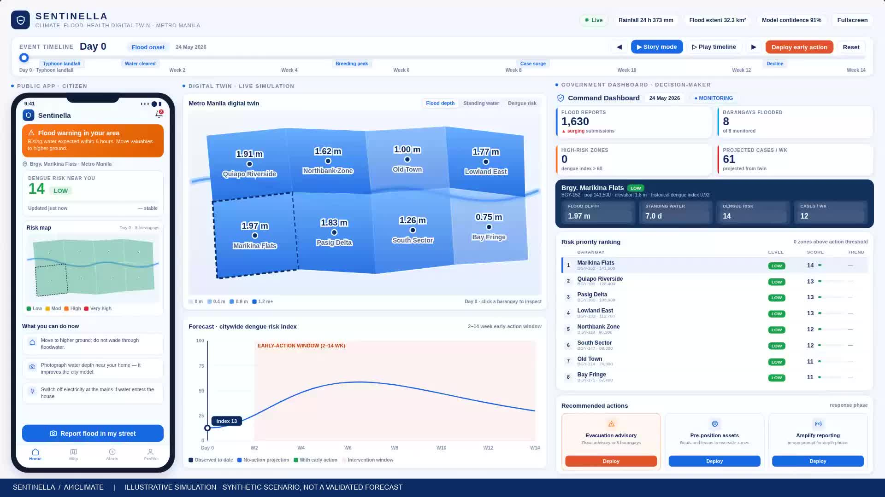

# Sentinella · AI4Climate Demo

**Climate · Flood · Health — earlier insight, earlier action.**

[Open the demo](https://joy9163.github.io/sentinella-ai4climate-demo/) · [中文项目页](index.html)



Sentinella is a research prototype for health and community inspection teams in Quezon City / Metro Manila, Philippines. The demo connects a synthetic resident report, flood and standing-water scenario, city-level research evidence, and a proposed human-reviewed inspection workflow.

## Explore

- **Interactive story** — use **Story mode** or the timeline to explore the synthetic early-action workflow.
- **50-second video** — an overview of the same illustrative scenario.
- **Historical evaluation summary** — compare 1-, 2- and 4-week aggregate errors and read the study limitations.
- **GFD event-model summary** — a small retrospective comparison using satellite flood-pixel fractions.
- **Research plan PDF** — data provenance, methods, results and the proposed 90-day pilot.

## Research status

The main target is a seven-day city case total starting 1, 2 or 4 weeks after issue. Exploratory 2018–2022 replay used quarterly expanding training and assumed seven-day case and weather delays. At four weeks, case-model MAE was **40.66** versus **58.75** for persistence (226 matched dates). Performance varies by period; added weather did not improve the case model.

The separate GFD experiment matched nine selected events and held out three later events. Added flood features slightly lowered one-week error and raised two- and four-week error. The sample is too small to establish predictive gain, and historical GFD publication timing remains unverified.

**The interactive story uses synthetic data.** Its neighbourhood risk scores, intervention benefits and cases averted are illustrative. This repository provides no validated live public warning, individual diagnosis or demonstrated disease-prevention effect.

## Run locally

No build, account, API key or package installation is needed.

```bash
python3 -m http.server 8000
```

Open `http://localhost:8000`. The frontend is plain HTML/CSS/JavaScript and works on GitHub Pages.

## Repository contents

- `index.html`: public project landing page and demo tabs.
- `故事动画.html`: self-contained interactive synthetic story.
- `历史预测演示.html`: aggregate historical-evaluation summary.
- `GFD_事件模型探索/README.html`: aggregate event-model summary.
- `Sentinella-AI4Climate-story.mp4`: 50-second scenario video.
- `项目完善与实验结果.pdf`: research methods and plan.
- `数据来源/`: source notes and an empty sensor-data template.

## Data and reuse

This is the public demo repository, not the full local research-data archive. Raw case tables, patient-level data, per-date case/prediction series, third-party source maps, trained weights and credentials are not included. See [data provenance and reuse](DATA_PROVENANCE.md).

No blanket open-source or media reuse licence is granted by this repository. Third-party datasets retain their own terms. Contact the repository owner before redistributing team assets.

## 中文说明

这是 Sentinella 的公开演示仓库，面向菲律宾奎松市／马尼拉大都会的拟议研究场景。页面保留故事动画、视频、历史评估汇总与洪涝模型摘要。原始研究数据保留在本地核验包；当前尚无已确认部署、实时预警或减少病例的证据。
